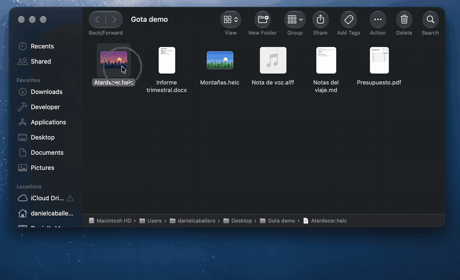

# Gota 💧

**A free, open-source file converter for macOS with a Liquid Glass wheel.**
Start dragging a file in Finder, hold **⇧**, and drop it on a format. Your files never leave your Mac.

*[Leer en español](README.es.md)*

<p align="center"></p>

| Key while dragging | Wheel |
|---|---|
| **⇧ Shift** | **Convert** — images (PNG, JPEG, HEIC, TIFF, PDF), PDF → Word / images / text, Word and text documents → PDF / Word / text / HTML, Markdown → PDF / Word / HTML, PowerPoint and Keynote → PDF / PNG / JPEG per slide, video (MP4, MOV, audio only), audio (M4A, WAV, AIFF) |
| **⌥ Option** | **Tools** — compress / resize images, merge / split / rotate PDFs, compress video to 720p |
| **⌃ Control** | **Actions** — AirDrop, ZIP, copy path, reveal in Finder |

With several files, every conversion comes in two flavours: one result per file, or everything in one (*PDF unido*,
*Word unido*, *ZIP*…).

## Download

**[⬇︎ Download the latest release](https://github.com/DANIIcs/Gota/releases/latest)** — macOS 26 or later, Apple Silicon or Intel.

1. Download `Gota-X.Y.Z.zip` under *Assets*, unzip it and move **Gota.app** to **Applications**.
2. The first time, macOS blocks it because it isn't notarized by Apple yet: go to **System Settings → Privacy &
   Security → Open Anyway**. You only do this once.
3. Look for the 💧 in the menu bar. Updates: 💧 → *Buscar actualizaciones…*.

Full guide (verifying the download, permissions, updating, uninstalling) — Spanish: **[docs/INSTALAR.md](docs/INSTALAR.md)**.

## Why another one?

There are radial converters for the Mac already (Gota is inspired by them). Gota's goal is to be **free, open and
feel like part of macOS**:

- Built with **SwiftUI's Liquid Glass**: the central drop splits into bubbles and merges back like liquid, using the
  system's own material, so it follows light/dark mode, accessibility settings and future macOS design updates.
- **Native frameworks first** (ImageIO, PDFKit, AVFoundation, afconvert): small, fast, hardware accelerated.
- **The most faithful engine per format, measured against Word and PowerPoint** ([docs/MOTORES.md](docs/MOTORES.md)):
  a bundled engine for `.docx` ([docxide-pdf](https://github.com/sverrejb/docxide-pdf), nothing to install), LibreOffice
  for other Office files when installed, macOS for plain text, Microsoft Office (exact layout) if you turn it on.
- **Missing fonts handled**: if a Word document uses an open-source font you don't have (Poppins, Montserrat…), Gota
  fetches it once so the PDF matches Word, and tells you when a proprietary font is missing.
- **Settings like System Settings**, an icon that follows your icon style, and your Mac's own alert sound.

## Privacy

**Your files never leave your Mac.** Every conversion runs locally and there is no telemetry. Gota only goes online
in two cases, both explained in [SECURITY.md](SECURITY.md):

- **Checking for updates** — when you click *Buscar actualizaciones…*, or once a day if you turn that on (off by default).
- **Missing open-source fonts** — when a Word document needs one, Gota downloads it once from Google Fonts. Only the
  font's name is sent, never your document. You can turn it off in *Ajustes → Motores → Fuentes*.

Results are saved next to the original and never overwrite anything.

## Build from source

macOS 26 or later, Xcode 26+ and [XcodeGen](https://github.com/yonaskolb/XcodeGen). [Rust](https://rustup.rs) is optional:
it builds the bundled `.docx` engine; without it, `.docx` files use LibreOffice.

```bash
brew install xcodegen
Engines/docxide/build.sh   # optional, needs Rust
xcodegen
open Gota.xcodeproj        # then ⌘R
```

Guides (Spanish): setup [docs/GUIA.md](docs/GUIA.md), how the engines work [docs/COMO-FUNCIONA.md](docs/COMO-FUNCIONA.md),
adding a format [docs/AGREGAR-CONVERSION.md](docs/AGREGAR-CONVERSION.md). Releases: `scripts/release.sh --publish`.

## Security

Crafted files can't pull other files from your Mac into a result, oversized documents are refused, and every change
goes through secret scanning, static analysis, a dependency audit and the test suite. To report a vulnerability
privately: [SECURITY.md](SECURITY.md).

## Status

Version 0.2 — usable every day, still young. Bugs and ideas are welcome in
[Issues](https://github.com/DANIIcs/Gota/issues).

## Credits

[docxide-pdf](https://github.com/sverrejb/docxide-pdf) (Apache-2.0) converts `.docx`; Carlito (OFL) and Caladea
(Apache-2.0) stand in for Calibri and Cambria. Licenses ship inside the app ([Engines/Licenses](Engines/Licenses)).

## License

[MIT](LICENSE)
